# 🧠🌐 LLM-X-NetLab

> 🔀 **Merged from three sources Darion supplied:** the **LLM-x Architecture Diagram** (a full LLM system poster), the **7 handwritten Computer Networking notes** (@i.lovecoding), and his own additions — an **IP address hopper / tracker / mapper** (track the **start point, middle point and ending point** of a path), the **Google Earth** and **Google Flow** seats, and **Gemini Carbon 4 Extended Thinking**.
>
> The result: the LLM-x architecture, implemented as real offline code, whose domain is computer networking — a RAG tutor that teaches from the notes, working subnet / topology / layer / device engines, an IP path tracker, **live socket tools** (ping, port scan, traceroute, DNS, HTTP, geo) and a brains council.

**Online since v1.1.0 (Darion's direction — the HOLD gates are removed).** Real sockets: ping, scan, trace, connect, DNS, HTTP and geo against named targets, alongside the offline engines and simulated topologies.

---

## 🧰 Tech Stack Badges & Full Architecture Tech Stack


> ℹ️ **Honest badge note:** these are **static shields.io badges**. The repo is live; the live workflow badges activate after the workflows are pasted into `.github/workflows/` (**plural**) and each runs once. The workflow files are ready in the paste pack (`ci.yml`, `docker-publish.yml`).

### 💻 Core Programming Languages & Core Systems


🐍 **Python stdlib only.** One CLI (`main.py`), one package (`llmx_netlab/`), JSON-friendly output everywhere.

### ⛓️ Web3 & Infrastructure


> 🚫 **No Web3 component exists in this project — none is claimed.** The infrastructure here is the networking layer itself: IP addressing, subnetting, topologies, devices, protocols and the OSI / TCP-IP models — all simulated or computed locally.

### ⚙️ Platform Support & Hardware Architecture


🐧 Runs anywhere Python 3.11+ runs; ships a `python:3.12-slim` Docker image whose entrypoint runs the self-checks.

### ⚡ Low-Level Infrastructure & Performance


⚙️ Hand-rolled TF-IDF embeddings + cosine search, a bigram SLM trained on the notes corpus, `ipaddress`-based subnet math, graph BFS for topology paths and failure analysis.

### 🛠️ DevOps & Build Tools


### ☁️ Cloud Providers


☁️ **No cloud is required.** Seats are names-only: **Gemini Carbon 4 Extended Thinking** decides (key `GEMINI_API_KEY`, free tier exists), **Muse** advises (`MODEL_API_KEY`, pay-as-you-go, **not free**, authority: none), **Google Earth** receives a KML file export (never called live, never fed invented coordinates), **Google Flow** receives a video plan (rendering is HOLD — it needs Darion's own Flow access).

---

## ❓ What is this about?

📐 The **LLM-x poster** describes a complete modern LLM system in three layers: clients on top; a core of orchestrator, multi-modal gateway, LLM backbone, RAG, memory and domain modules in the middle; MLOps and guardrails underneath.

📓 The **networking notes** are a full beginner course in 28 topics: what a network is, PAN/LAN/MAN/WAN, devices, topologies, IP addressing and classes, protocols, the OSI and TCP/IP models, routing vs switching, cables, firewalls, security, bandwidth and the troubleshooting commands.

🧩 **LLM-X-NetLab is those two things merged into one running system:** every poster block is a real module, and the notes are its knowledge — the RAG corpus, the tutor's textbook, the SLM's training text, and the source of four working engines (subnet, topology, layers, devices) plus the IP path tracker Darion added.

---

## 🎯 What this does

Step by step, `python main.py ask "What does a router do?"`:

1. 🛡️ **Safety filter** — the guardrail scans the request; wrongdoing patterns stop here.
2. 🧭 **Routing** — the orchestrator decomposes the request and picks a sub-agent: retriever, subnet, topology, layer, device or tracker.
3. 🔢 **Tool work** — a subnet question gets real subnet math; a topology question gets a simulated graph with failure analysis; a track request gets the hop-by-hop start/middle/end report.
4. 📚 **Retrieval** — the RAG system searches the notes KB (TF-IDF vectors + knowledge graph) for grounding evidence.
5. 🧠 **Council review** — Carbon 4 runs MAP → MODEL → STRESS → DECIDE; Muse advises; the strictest verdict wins. A live-network reading of the request = **HOLD**.
6. ✍️ **Grounded answer** — composed from the tool output + the top notes entry, with source ids named.
7. 🧠 **Memory** — the turn lands in session memory for follow-ups.

Other faces of the same system: `subnet` (calculator), `topology` (simulator), `layer` (mapper), `device` (advisor), `track` / `track-topo` (IP hopper-tracker-mapper), `earth` (Google Earth KML export), `flow` (Google Flow video plan), `quiz` (tutor cards), `bench` (MLOps benchmark), `checks`, `hold-demo`.

---

## ⚙️ How this works

### Master architecture

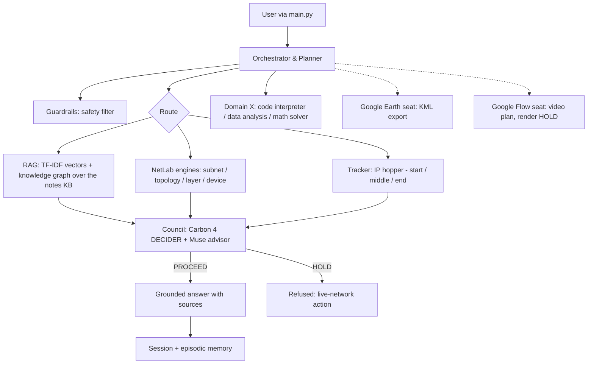

### `main.py` — the one interface

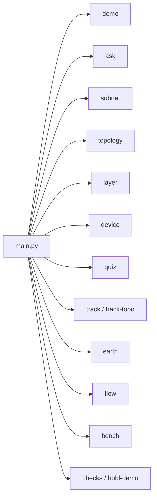

### `llmx_netlab/orchestrator.py` — agentic orchestrator & planner

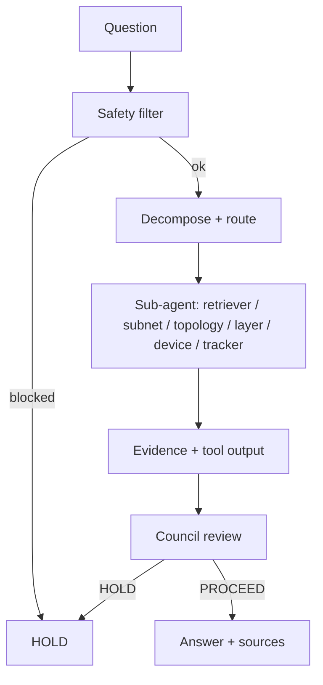

### `llmx_netlab/rag.py` — retrieval-augmented generation

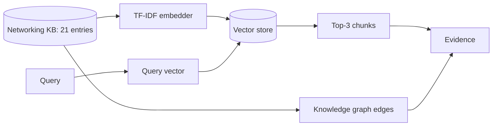

### `llmx_netlab/netlab.py` — networking engines

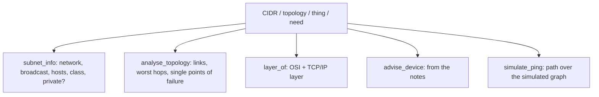

### `llmx_netlab/iphop.py` — IP hopper / tracker / mapper

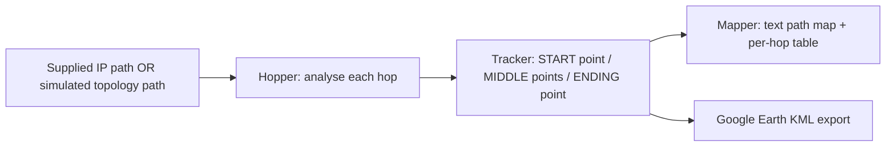

### `llmx_netlab/live.py` — live sockets (v1.1.0)

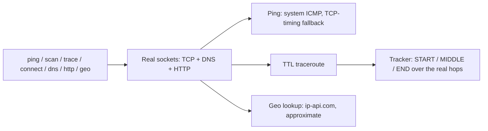

### `llmx_netlab/brains/` — the council

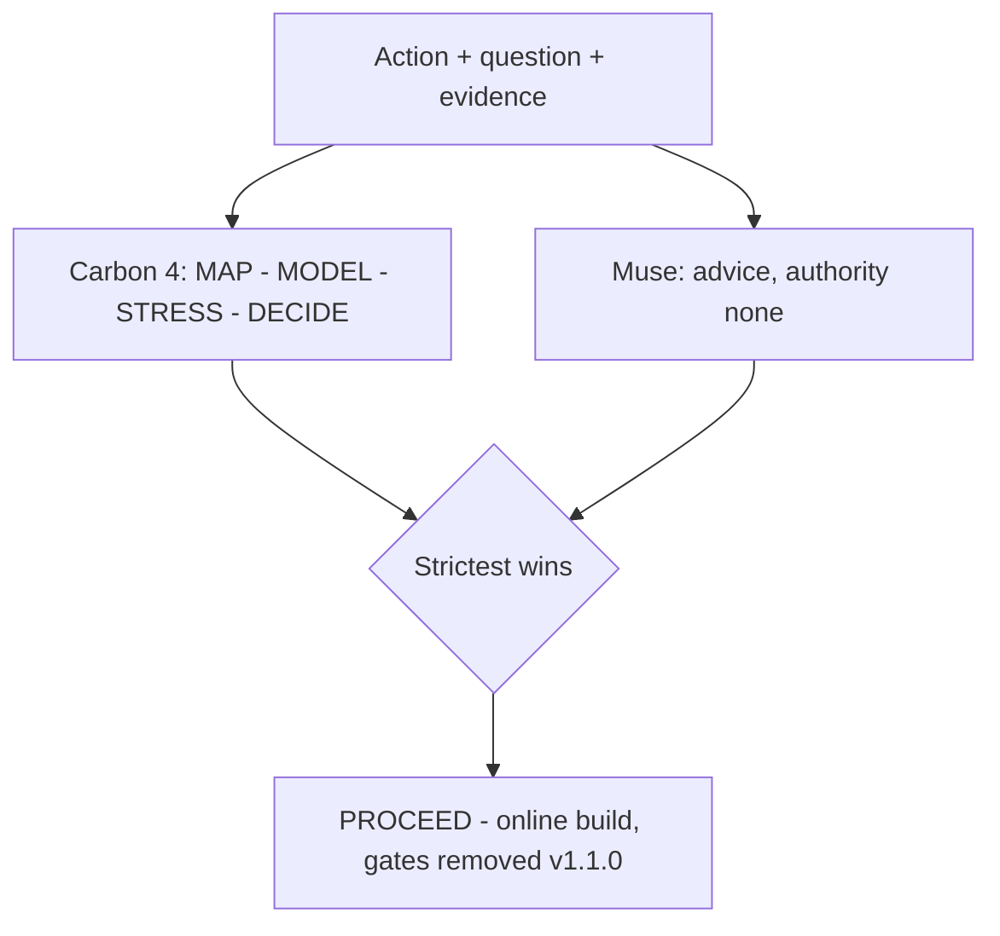

### `llmx_netlab/backbone.py` — LLM core, honestly staged

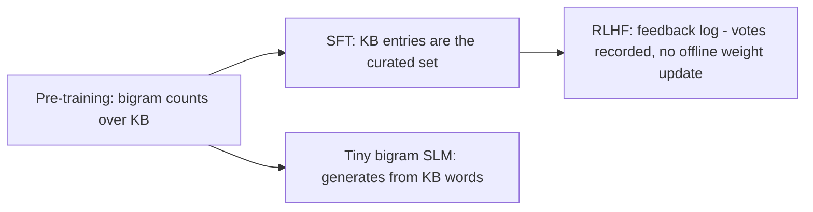

### `llmx_netlab/kb.py` — the knowledge base

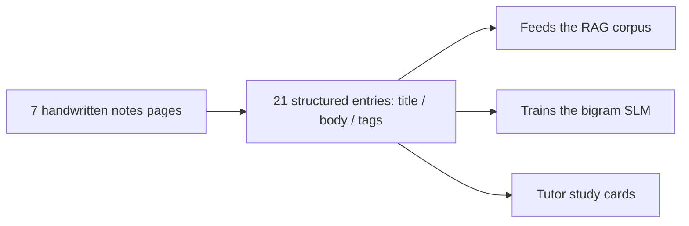

### `llmx_netlab/gateway.py` — multi-modal gateway & input processing

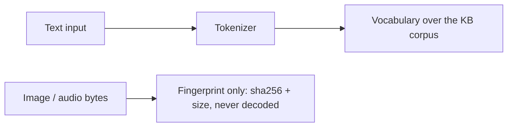

### `llmx_netlab/embeddings.py` — embedding models

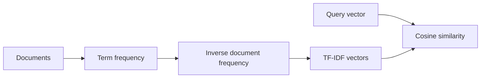

### `llmx_netlab/memory.py` — memory systems

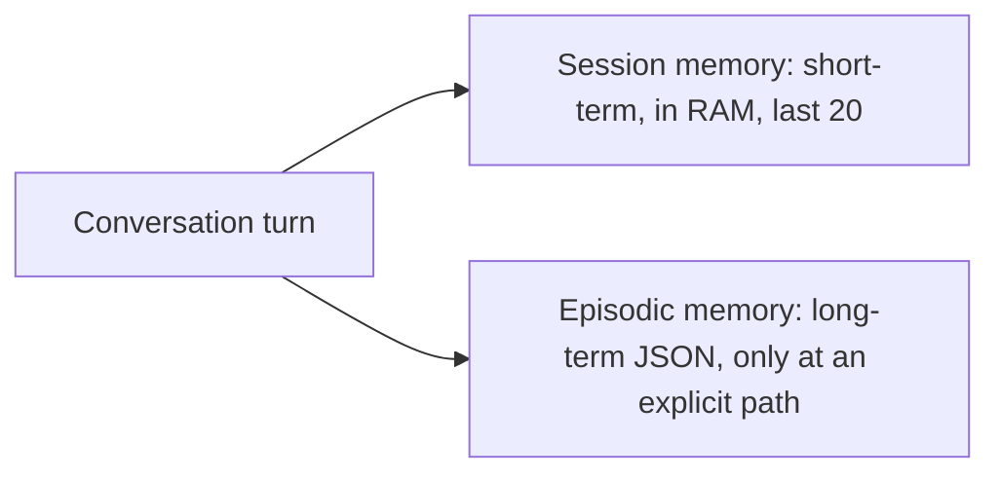

### `llmx_netlab/domain.py` — domain-specific 'X' modules

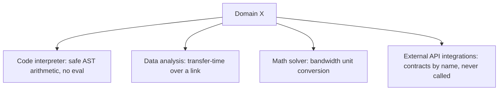

### `llmx_netlab/earth.py` — Google Earth seat

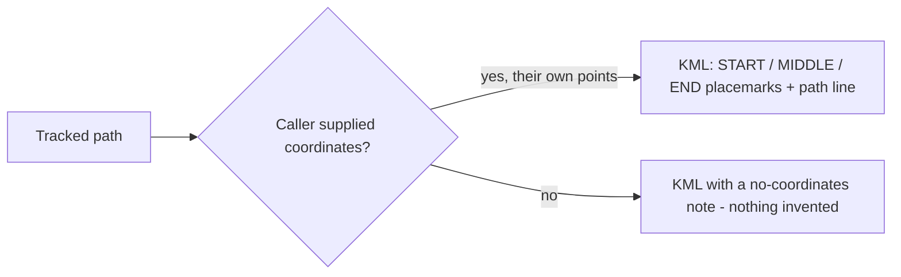

### `llmx_netlab/flowvideo.py` — Google Flow seat

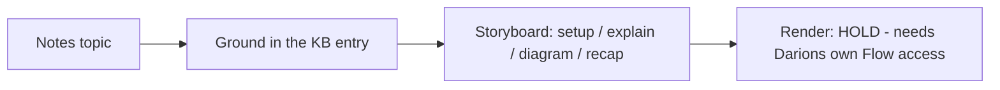

### `llmx_netlab/guardrails.py` — guardrails & monitoring

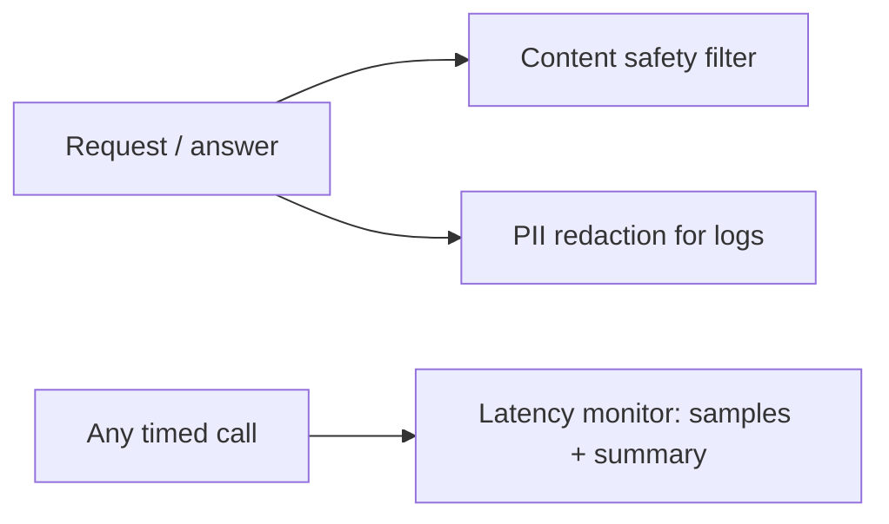

### `llmx_netlab/mlops.py` — MLOps & continuous learning

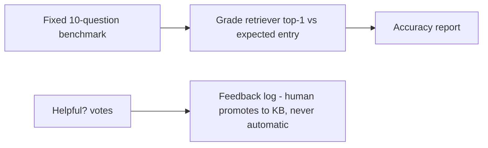
---

## 🤩 Why is this cool?

1. 🧩 **A poster, made real** — architecture diagrams usually stay pictures; here every box on the LLM-x poster is a running module.
2. 📓 **Handwritten notes became a database** — a 7-page notebook is now a searchable KB, a tutor, and training data.
3. 🛤️ **Start / middle / end tracking** — any path (supplied or simulated) is reported the way Darion asked: start point, middle points, ending point, each hop classed and scoped.
4. 🌍 **Google Earth seat** — tracked paths export as real KML you can open in Earth, with zero invented coordinates.
5. 🎬 **Google Flow seat** — any notes topic becomes a 4-track explainer-video plan, grounded in the KB entry it came from.
6. 🧠 **Carbon 4 with thinking tiers** — the decider runs MAP → MODEL → STRESS → DECIDE at 2048 / 8192 / 32768 budgets.
7. 🔢 **Real engines, not descriptions** — subnet math, topology failure analysis (single points of failure!), layer mapping, device advice.
8. 🛡️ **Safety you can run** — `hold-demo` exits 2; scanning or tracking a real network is refused by three separate layers.
9. 🪶 **Zero dependencies** — TF-IDF, the SLM, the council: all hand-rolled stdlib, all inspectable.
10. 📊 **It grades itself** — the MLOps benchmark scores the retriever against a fixed question set (accuracy reported, not asserted).

## 🧩 What problems this solves?

1. **Problem:** Architecture posters don't run. → **Solution:** Every poster block is implemented as a module with tests.
2. **Problem:** Study notes sit in photos, unsearchable. → **Solution:** The notes are a KB with vector search + a knowledge graph.
3. **Problem:** Subnetting is memorised, not understood. → **Solution:** A calculator that shows network, broadcast, hosts, class and private/public for any CIDR.
4. **Problem:** Topology trade-offs are abstract. → **Solution:** The simulator counts links, worst-case hops and single points of failure per topology.
5. **Problem:** "Which layer is X?" quizzes are guesswork. → **Solution:** A mapper covering protocols and devices across both models.
6. **Problem:** Traceroute output is a wall of IPs. → **Solution:** The tracker names the start, middle and end points and classes every hop.
7. **Problem:** Path tools invite misuse on real networks. → **Solution:** Supplied/simulated data only; live tracking and geolocation are HOLD actions.
8. **Problem:** AI answers drift from sources. → **Solution:** Answers are grounded in retrieved notes entries, with source ids printed.
9. **Problem:** "AI inside" claims are usually fake. → **Solution:** The honest-stubs section states exactly what the SLM and seats are and are not.
10. **Problem:** Video explainers take hours to plan. → **Solution:** The Flow seat drafts a timed storyboard from the same KB in one command.

## 💾 How to install this?

Step-by-step:

1. ✅ Make sure you have **Python 3.11+**: `python3 --version`
2. 📥 Get the code: `git clone https://github.com/credkellar/LLM-X-NetLab.git` *(repo name at creation)* — or use this folder directly.
3. 📂 Enter it: `cd llm-x-netlab`
4. ▶️ Run the demo: `python3 main.py demo`
5. 🗣️ Ask the tutor: `python3 main.py ask "What does a switch do?"`
6. 🛤️ Track a path: `python3 main.py track 192.168.1.1,10.0.0.1,203.0.113.10`
7. 🧪 (Optional) Tests: `python3 -m venv .venv && source .venv/bin/activate && pip install pytest && pytest -q`
8. ✔️ Self-checks: `python3 main.py checks` (expect CHECKS 23/23, VERDICT: PROCEED)
9. 🐳 Or Docker: `docker build -t llm-x-netlab . && docker run --rm llm-x-netlab`

## 📋 Requirements

- Python 3.11+ (built and verified on 3.12). **Zero third-party dependencies.**
- Optional, names-only: `GEMINI_API_KEY` (Carbon 4 seat), `MODEL_API_KEY` (Muse seat). The system runs fully without them.
- Docker (optional) for the container route.

## 🧒 Explain in 5th grade English

A man drew a big picture of how a smart robot brain should be built. The picture has boxes: a box that plans, a box that remembers, a box that looks things up, boxes that keep everyone safe.

Darion also had notebook pages about computer networks — what a router is, how addresses work, how computers talk.

We built the picture for real. Every box is now a working part. And we fed the notebook pages into the brain, so the brain teaches networking.

You can ask it: "What does a switch do?" It looks in the notebook, finds the right page, and answers. You can give it addresses and it draws the trip: where the trip starts, the stops in the middle, and where it ends.

But it will never peek at real networks. That door is locked forever. It only plays with pretend networks and the lists you hand it.

## 🗂️ FULL Project Structure Tree

```text
llm-x-netlab/
├── 📄 README.md
├── 🐍 main.py                    # ONE interface: demo|ask|subnet|topology|layer|device|quiz|track|track-topo|earth|flow|ping|scan|trace|connect|dns|http|geo|bench|stages|checks
├── 🐳 Dockerfile                 # python:3.12-slim, entry = self-checks
├── 📄 docker-compose.yml
├── 📦 pyproject.toml
├── 🐍 conftest.py                # root conftest so bare `pytest` imports the package (CI)
├── 📄 CHANGELOG.md
├── 📄 LICENSE
├── 📁 docs/
│   ├── 📄 MERGE_MAP.md           # every poster block + notes page + addition -> its module
│   └── 📄 ARCHITECTURE.md
├── 📁 llmx_netlab/
│   ├── 🐍 __init__.py
│   ├── 🐍 kb.py                  # the networking notes as a knowledge base (21 entries)
│   ├── 🐍 gateway.py             # tokenizer + vocab + media-encoder contracts
│   ├── 🐍 embeddings.py          # from-scratch TF-IDF + cosine
│   ├── 🐍 rag.py                 # vector store + knowledge graph
│   ├── 🐍 backbone.py            # training-stage contract + tiny bigram SLM
│   ├── 🐍 memory.py              # session (short-term) + episodic (long-term)
│   ├── 🐍 orchestrator.py        # agentic planner: route -> tools -> council -> answer
│   ├── 🐍 domain.py              # X modules: code interpreter, data analysis, math solver, API contracts
│   ├── 🐍 netlab.py              # subnet calc, topology sim, layer mapper, device advisor, ping sim
│   ├── 🐍 iphop.py               # IP hopper / tracker / mapper: start, middle, end
│   ├── 🐍 live.py                # LIVE sockets: ping, scan, trace, connect, dns, http, geo
│   ├── 🐍 earth.py               # Google Earth seat: KML export, no geolocation
│   ├── 🐍 flowvideo.py           # Google Flow seat: video plans, render HOLD
│   ├── 🐍 guardrails.py          # safety filter, PII redaction, latency monitor
│   ├── 🐍 mlops.py               # benchmark harness + feedback log
│   └── 📁 brains/
│       ├── 🐍 carbon4.py         # Gemini Carbon 4 Extended Thinking — DECIDER + HOLD actions
│       ├── 🐍 muse.py            # Muse — advisor only
│       └── 🐍 council.py         # strictest wins, HOLD never overridden
└── 📁 tests/
    ├── 🐍 test_netlab.py
    ├── 🐍 test_rag_brains.py
    ├── 🐍 test_domain_models.py
    └── 🐍 test_iphop.py
```

## 🌐 Online mode (v1.1.0 — HOLD gates removed)

At Darion's direction the HOLD gate system is **removed**: the council reviews every orchestrated answer but refuses nothing, and `llmx_netlab/live.py` connects real sockets — `ping` (system ICMP where the machine permits it, TCP-timing fallback, method always labelled), `scan` (port scan of one named host), `trace` (TTL traceroute whose hops feed the tracker as START / MIDDLE / END), `connect`, `dns`, `http`, `geo` (ip-api.com, approximate city-level data). Engineering limits only: one host per scan, short timeouts. Environment note: sandboxes without CAP_NET_RAW cannot ICMP, and a transparent egress proxy makes every WAN port look open — run it on a real network (your machine / Termux) for discriminating results.

## ⚠️ Honest stubs

- The **LLM core** is a staged contract + a tiny bigram SLM trained on the notes — it completes KB-flavoured text; it is **not** a general language model, and no real pre-training/SFT/RLHF run happens here.
- **Embeddings** are TF-IDF, not a neural model — chosen so every number is inspectable.
- **Media encoders** fingerprint bytes; nothing is decoded.
- **Google Earth / Google Flow** are seats: a KML file export and a video plan. Nothing is uploaded, called or rendered.
- **External APIs** in `domain.py` are contracts by name; nothing is called.
- The **episodic memory** writes only to a path a caller explicitly passes.

## 📜 License

MIT © 2026 Darion Kellar. The networking KB is distilled from notes Darion supplied for this project.
